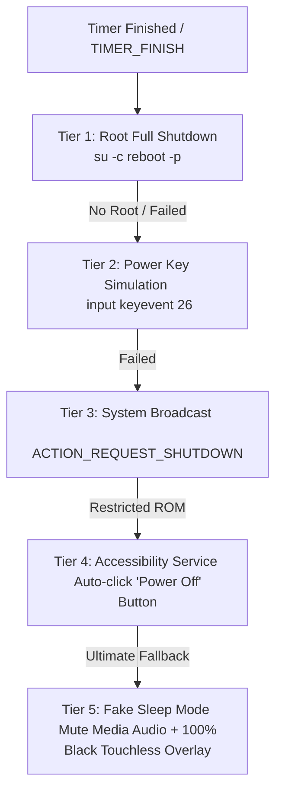

# 📺 Android TV Turn-Off Timer & Browser

<div align="center">

<p>
  <b>Language:</b>
  <b>🇺🇸 English</b> |
  <a href="README_TR.md">🇹🇷 Türkçe</a>
</p>


<p align="center">
  <b>An open-source Sleep Timer and YouTube TV Browser for Android TV and TV Box devices, featuring progressive screen dimming, idle inactivity detection, and a 5-tier intelligent shutdown / sleep fallback engine.</b>
</p>

</div>

---

## 🌟 Key Features

- **⏱️ Quick & Custom Timers:**
  - One-click quick presets: **15 Min**, **30 Min**, **1 Hour**, and **3 Hours**.
  - Intuitive **`+` / `-`** stepper buttons or numeric direct input for custom minute-level duration.
  - Live real-time countdown display (`00:00:00`) synchronized with foreground system notification.

- **🌑 Gradual Screen Dimming:**
  - Non-intrusive translucent black screen overlay (`SYSTEM_ALERT_WINDOW`) that dims the display gradually before the timer ends to reduce eye strain.
  - **Flexible Dimming Modes:** *Only at the end*, *Final 5 Mins*, *Final 10 Mins*, *Final 15 Mins*, *Final 30 Mins*, or full duration progressive fade.

- **🌐 Built-in YouTube TV / Web Browser:**
  - Fullscreen WebView browser optimized for TV remote navigation (`https://www.youtube.com/tv`).
  - **Inactivity Idle Dimmer:** Automatically dims the screen to ~80% black after 1 minute of remote inactivity; immediately brightens back upon any button press.
  - Translucent live timer badge in the corner of the browser.

- **🛡️ 5-Tier Resilient Power Fallback Engine:**
  - A robust multi-tier fallback mechanism ensuring the device shuts down or enters deep sleep even across heavily customized AOSP / Chinese TV ROMs.

---

## ⚡ 5-Tier Power Fallback Architecture

Many Android TV boxes and OEM ROMs strip or restrict standard shutdown APIs. This app employs a descending 5-tier fallback cascade to guarantee reliable sleep or power-off:



1. **Tier 1 (Root Full Shutdown):** If root permissions (`su`) are available, triggers direct hardware shutdown (`reboot -p`).
2. **Tier 2 (Power Keyevent):** Simulates a remote control Power button click (`input keyevent 26`) to place the device into standby/sleep.
3. **Tier 3 (System Broadcast):** Fires Android's native system shutdown intent (`android.intent.action.ACTION_REQUEST_SHUTDOWN`).
4. **Tier 4 (Accessibility Auto-Click):** Uses `PowerAccessibilityService` to inspect the UI node hierarchy when the global power menu opens and automatically dispatches a tap gesture on the *"Shut down / Power off / Kapat"* item.
5. **Tier 5 (Ultimate Fake Sleep):** If the OS rejects all shutdown requests, it completely mutes media audio (`AudioManager.STREAM_MUSIC -> 0`) and covers the entire display with a 100% pitch-black, non-touchable overlay (`WindowManager.LayoutParams.FLAG_NOT_TOUCHABLE`), effectively sending the TV into a safe, silent sleep state.

---

## 🗂️ Project Structure

```
Android-TV-Turn-Off-Timer-Browser/
├── app/
│   ├── src/main/
│   │   ├── AndroidManifest.xml              # TV Leanback, activities, services & permissions
│   │   ├── java/com/kapeks/turnofftimer/
│   │   │   ├── MainActivity.java            # Main TV dashboard & timer controls
│   │   │   ├── BrowserActivity.java         # YouTube TV browser & idle dimmer logic
│   │   │   ├── TimerService.java            # Foreground service, overlay & fallback engine
│   │   │   ├── PowerAccessibilityService.java # Accessibility auto-clicker service
│   │   │   └── MyDeviceAdminReceiver.java   # Device admin lock receiver
│   │   └── res/
│   │       ├── layout/                      # activity_main.xml & activity_browser.xml
│   │       ├── values/                      # strings.xml, themes.xml
│   │       └── xml/                         # accessibility_service_config, device_admin
│   ├── build.gradle                         # App dependencies, compileSdk 34, minSdk 23
│   └── proguard-rules.pro                   # ProGuard rules
├── gradle/wrapper/                          # Gradle Wrapper (8.4)
├── build.gradle                             # Root build script
├── settings.gradle                          # Module definitions
├── gradle.properties                        # AndroidX configuration
├── gradlew & gradlew.bat                    # Gradle Wrapper launcher scripts
├── .gitignore                               # Excludes build caches, local.properties & APKs
├── LICENSE                                  # MIT License
└── README.md & README_TR.md                 # Multilingual documentation
```

---

## 📋 Required Permissions

| Permission | Purpose |
| :--- | :--- |
| **`SYSTEM_ALERT_WINDOW`** | Allows rendering the translucent dimming overlay and pitch-black fake sleep layer over other apps. |
| **`FOREGROUND_SERVICE`** | Keeps the countdown timer active in background without being killed by Android memory manager. |
| **`WAKE_LOCK`** | Prevents CPU throttling while the countdown runs. |
| **`INTERNET`** | Loads the YouTube TV WebView and web content. |
| **`BIND_ACCESSIBILITY_SERVICE`** | *(Optional)* Inspects and automatically clicks the power dialog button. |

---

## 🚀 Build and Installation

### 1. Clone the Repository
```bash
git clone https://github.com/okanyyurt/Android-TV-Turn-Off-Timer-Browser.git
cd Android-TV-Turn-Off-Timer-Browser
```

### 2. Build the APK

#### Windows (PowerShell / Command Prompt):
```powershell
.\gradlew.bat assembleRelease
```

#### Linux / macOS:
```bash
chmod +x gradlew
./gradlew assembleRelease
```

The generated APK will be available in `app/build/outputs/apk/release/`.

### 3. Sideload via ADB (Wireless / USB)
```bash
adb connect 192.168.1.xxx:5555
adb install -r app/build/outputs/apk/release/app-release.apk
```

---

## 📄 License

Distributed under the [MIT License](LICENSE). Feel free to use, modify, and distribute for personal or commercial purposes.

---

## 👨‍💻 Author

**Okan Yeşilyurt**
- GitHub: [@okanyyurt](https://github.com/okanyyurt)
