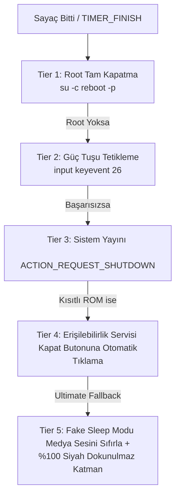

# 📺 Android TV Turn-Off Timer & Browser (Kapanma Zamanlayıcısı ve Tarayıcı)

<div align="center">

<p>
  <b>Dil Seçimi / Language:</b>
  <a href="README.md">🇺🇸 English</a> |
  <b>🇹🇷 Türkçe</b>
</p>


<p align="center">
  <b>Android TV ve TV Box cihazları için geliştirilmiş; kademeli ekran karartma, dahili YouTube TV tarayıcısı, hareketsizlik algılama ve 5 katmanlı akıllı kapatma/uyku (Power Fallback) motoruna sahip açık kaynaklı kapanma zamanlayıcısı.</b>
</p>

</div>

---

## 🆕 v1.012 Yenilikleri

- **Tarayıcıdan bağımsız zamanlayıcı:** Süre her uygulamada işler (YouTube uygulaması, Netflix, HDMI...). "İzle" satırından yüklü uygulamalar doğrudan açılabilir.
- **Her gün belirli saatte kapanma** (ör. 01:00). Kapanmadan 5 dk önce geri sayım başlar; açılışta alarm yeniden kurulur.
- **Tam ekran tarayıcı + ince kontrol barı** (altta/üstte). Geri tuşu uygulamayı kapatmaz; bar Geri'ye iki kez/uzun basınca veya Menü tuşuyla açılır.
- **1 dk uyarı paneli** (+15 dk / +30 dk / Şimdi kapat / İptal), kademeli karartma, sesin yavaşça kısılması, medyanın duraklatılması.
- **Doğrulamalı kapatma zinciri:** her yöntemden sonra ekranın kapandığı kontrol edilir; son denenen yöntem Ayarlar'da gösterilir.
- **Dişli simgeli Ayarlar sayfası:** izinler, test zamanlayıcısı, ADB komutları, kumanda kısayol tuşu.
- Güç simgeli uygulama ikonu ve Android TV afişi.

## 🌟 Öne Çıkan Özellikler

- **⏱️ Hızlı ve Özel Süre Ayarı:**
  - Tek tıkla **15 Dk**, **30 Dk**, **1 Saat** ve **3 Saat** hazır zamanlayıcı butonları.
  - Hassas **`+` / `-`** butonları veya sayısal giriş ile dilediğiniz dakikada özel zamanlayıcı başlatma.
  - Canlı geri sayım saati (`00:00:00`) ve bildirim çubuğu senkronizasyonu.

- **🌑 Akıllı Kademeli Ekran Karartma (Gradual Dimming):**
  - Süre dolmadan önce gözü yormayan ve uykuya geçişi kolaylaştıran saydam siyah ekran katmanı (`Overlay`).
  - **Döngüsel Kararma Seçenekleri:** *Sadece Sonda*, *Son 5 Dk*, *Son 10 Dk*, *Son 15 Dk*, *Son 30 Dk* veya süre boyunca kademeli kararma.

- **🌐 Dahili YouTube TV / Web Tarayıcısı:**
  - TV ekranları ve kumanda ile tam uyumlu tam ekran WebView tarayıcısı (`https://www.youtube.com/tv`).
  - **Hareketsizlik Karartması (Idle Dimmer):** Kullanıcı kumandaya 1 dakika boyunca dokunmadığında otomatik olarak %80 karartma uygular; kumandaya basıldığında uyanır.
  - Tarayıcı köşesinde şeffaf canlı geri sayım göstergesi.

- **🛡️ 5 Katmanlı Güvenilir Kapatma / Uyku Motoru (Power Fallback Engine):**
  - Çin menşeili veya standart dışı Android TV ROM'larında bile cihazın kapanmasını veya uyumasını garanti eden çok aşamalı mimari.

---

## ⚡ 5 Katmanlı Kapatma (Power Fallback) Mimarisi

Android TV cihazlarının birçoğunda üreticiye göre farklı yetkiler ve kısıtlamalar bulunur. Bu uygulama, süre dolduğunda cihazın kapanmasını veya ekranın kapanmasını garantiye almak için sırasıyla şu adımları dener:



1. **Tier 1 (Root Kapatma):** Root yetkisi varsa doğrudan donanımı kapatır (`reboot -p`).
2. **Tier 2 (Güç Tuşu Simülasyonu):** Kumandadaki güç tuşuna basılmış gibi uyku modunu tetikler (`input keyevent 26`).
3. **Tier 3 (Android Kapatma Yayını):** Standart Android kapatma diyalogunu çağırır (`ACTION_REQUEST_SHUTDOWN`).
4. **Tier 4 (Erişilebilirlik Servisi):** Açılan güç menüsünde *"Kapat" / "Power Off"* butonunu UI ağacında tespit edip otomatik olarak tıklar (`PowerAccessibilityService`).
5. **Tier 5 (Nihai Fake Sleep):** TV sistemi kapatmaya izin vermese dahi tüm medya seslerini susturur (`STREAM_MUSIC -> 0`) ve ekranın tamamını etkileşime kapalı (`FLAG_NOT_TOUCHABLE`) simsiyah bir katmanla örterek cihazı fiilen uyku durumuna geçirir.

---

## 🗂️ Proje Dizin Yapısı

```
Android-TV-Turn-Off-Timer-Browser/
├── app/
│   ├── src/main/
│   │   ├── AndroidManifest.xml              # TV Leanback & izin tanımları
│   │   ├── java/com/kapeks/turnofftimer/
│   │   │   ├── MainActivity.java            # Ana kontrol paneli & sayaç yönetimi
│   │   │   ├── BrowserActivity.java         # YouTube TV arayüzü & hareketsizlik sayacı
│   │   │   ├── TimerService.java            # Ön plan servisi, karartma & fallback motoru
│   │   │   ├── PowerAccessibilityService.java # Güç menüsü otomatik tıklama servisi
│   │   │   └── MyDeviceAdminReceiver.java   # Cihaz yöneticisi kilit alıcısı
│   │   └── res/
│   │       ├── layout/                      # activity_main.xml & activity_browser.xml
│   │       ├── values/                      # strings.xml, themes.xml
│   │       └── xml/                         # accessibility_service_config, device_admin
│   ├── build.gradle                         # Uygulama bağımlılıkları & SDK ayarları
│   └── proguard-rules.pro                   # ProGuard kuralları
├── gradle/wrapper/                          # Gradle Wrapper (8.4)
├── build.gradle                             # Kök derleme dosyası
├── settings.gradle                          # Proje modül ayarları
├── gradle.properties                        # AndroidX yapılandırması
├── gradlew & gradlew.bat                    # Gradle Wrapper komut dosyaları
├── .gitignore                               # Yerel dosyaları koruyan filtre
├── LICENSE                                  # MIT Lisansı
└── README.md & README_TR.md                 # Çift dilli dokümantasyon
```

---

## 📋 Gerekli İzinler

Uygulamanın tam randımanlı çalışabilmesi için aşağıdaki izinler kullanılır:

| İzin Adı | Kullanım Amacı |
| :--- | :--- |
| **`SYSTEM_ALERT_WINDOW`** | Ekran üzerine saydam karartma katmanı ve uyku ekranı yerleştirmek için (Diğer uygulamaların üzerinde göster). |
| **`FOREGROUND_SERVICE`** | TV arka planda video oynatırken sayacın sistem tarafından kapatılmasını önlemek için. |
| **`WAKE_LOCK`** | Sayacın uyku zamanına kadar hassas şekilde çalışmasını sağlamak için. |
| **`INTERNET`** | Dahili YouTube TV / WebView tarayıcısının çalışması için. |
| **`BIND_ACCESSIBILITY_SERVICE`** | *(Opsiyonel)* Güç menüsündeki kapatma butonuna otomatik tıklamak için. |

---

## 🚀 Derleme ve Kurulum

### 1. Repoyu Klonlayın
```bash
git clone https://github.com/okanyyurt/Android-TV-Turn-Off-Timer-Browser.git
cd Android-TV-Turn-Off-Timer-Browser
```

### 2. APK'yı Derleyin

#### Windows:
```powershell
.\gradlew.bat assembleRelease
```

#### Linux / macOS:
```bash
chmod +x gradlew
./gradlew assembleRelease
```

Derlenen APK dosyası `app/build/outputs/apk/release/` dizininde oluşturulacaktır.

### 3. Android TV / Box Cihaza Yükleme (ADB ile)
```bash
adb connect 192.168.1.xxx:5555
adb install -r app/build/outputs/apk/release/app-release.apk
```

---

## 📄 Lisans

Bu proje [MIT Lisansı](LICENSE) altında açık kaynak olarak paylaşılmıştır. Dilediğiniz gibi değiştirebilir, geliştirebilir ve kullanabilirsiniz.

---

## 👨‍💻 Geliştirici

**Okan Yeşilyurt**
- GitHub: [@okanyyurt](https://github.com/okanyyurt)
